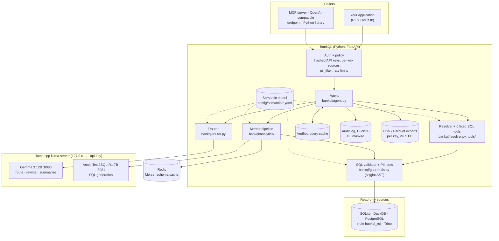
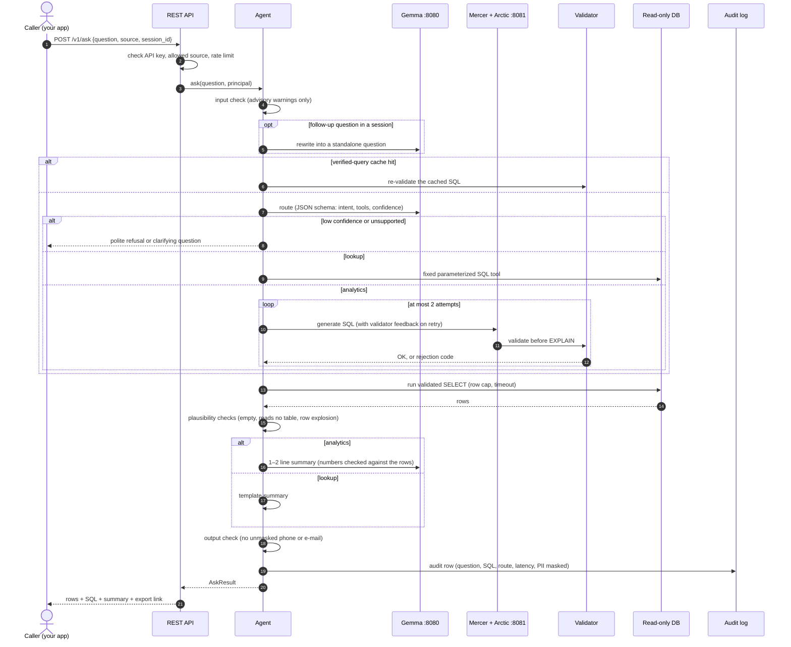

# BankQL

Natural-language questions over bank data, answered by **local open-weight models** (llama.cpp) with
**read-only, validated SQL**. Lookups ("show client 12's accounts") use fixed parameterized SQL; analytics
("which districts have the most loans in debt?") go through a ported [Mercer](https://github.com/baselanaya/Mercer)
pipeline. Rows always come straight from the database. See `SPEC.md` for the full brief and decisions,
`PROGRESS.md` for status, `docs/THIRD_PARTY.md` for what was reused and how it differs from the brief.

## How it works

### Architecture



Two paths, one rule: **every SQL statement passes the validator and runs on a read-only connection**, and rows
always come straight from the database, never from a model.

- **Lookup** ("show client 12's accounts"): the router picks one of six fixed, parameterized tools; the resolver
  turns names and ids into keys. No SQL is written by a model.
- **Analytics** ("which districts have the most loans in debt?"): Mercer asks Arctic for SQL, the validator checks
  it, and a rejected query goes back once with the error as feedback (at most 2 attempts).

### What happens to one question



### What the validator rejects

| Code | Meaning |
|---|---|
| `not_select`, `multi_statement`, `forbidden_node`, `forbidden_function` | anything that is not a single read-only SELECT |
| `table_not_allowed` | a table outside the source's allowlist |
| `pii_output`, `pii_filter_denied`, `pii_filter_shape`, `pii_unverifiable` | PII columns in the output, or used as a filter without permission (column lineage through joins, CTEs and UNIONs) |
| `unbounded_large_scan` | a large table scanned without a time filter |

Details: `docs/SECURITY.md`. The SQLAS checks run too, but only add warnings; enforcement is the validator.

## Quickstart (CPU, synthetic data)

```bash
uv sync                                   # Python 3.12 venv, exact pins from uv.lock
cp .env.example .env
sudo scripts/setup_postgres.sh            # local PG16: DB + bankql_admin + read-only bankql_ro (passwords → .env)
.venv/bin/python scripts/make_fixture.py  # synthetic BIRD-financial fixture → SQLite, DuckDB, Postgres
.venv/bin/python -m pytest -m "not real_llm"
```

Models (one at a time on CPU; both resident on a GPU — see "GPU" below):

```bash
uv venv -p 3.12 .venv-llama && CMAKE_ARGS="-DGGML_NATIVE=ON" uv pip install -p .venv-llama "llama-cpp-python[server]==0.3.16"
.venv-llama/bin/python -m llama_cpp.server --model models/<gemma-12b>.gguf --port 8080 --n_threads 4 --n_ctx 8192
.venv/bin/uvicorn bankql.api:app --port 8000
```

`config/models.yaml` holds endpoints, the Gemma GGUF repo/file (owner-supplied), the router confidence
threshold (0.6 is a **starting value**, to be calibrated on the Phase 3 lookup eval) and `sql.mode`
(`fast` = 1 candidate at T=0, no decomposition; `full` = Mercer's 6 stages).

## Safety model

| Layer | What it does |
|---|---|
| Connection | SQLite opened `mode=ro` + `query_only`; DuckDB `read_only`; Postgres role `bankql_ro` (SELECT-only, `default_transaction_read_only=on`) + `SET TRANSACTION READ ONLY` per query. Every query in a rolled-back transaction with a statement timeout and row cap. |
| Validator (`bankql/guardrails.py`) | sqlglot AST: exactly one `SELECT`/`WITH…SELECT`; no DDL/DML anywhere (CTEs, subqueries), no `SELECT INTO`, `FOR UPDATE`, PRAGMA/ATTACH/COPY/SET; no file/sleep/settings functions or table functions; allowlisted tables only. What runs is re-rendered from the validated AST. |
| PII | Output-column **lineage** (sqlglot qualify + scopes): PII may be filtered on or `COUNT`ed, never returned by analytics SQL (`CONCAT`, `CASE`, CTEs, subqueries, `UNION`, window functions all traced). Lookup tools may return the synthetic name and masked phone. PII values are never sent to the model as schema samples. |
| Large tables | Tables flagged in `sources.yaml` need a bounding filter on their `time_column` once the EXPLAIN row estimate exceeds the threshold. |
| SQLAS | `check_input` (injection / malicious intent / credential / bypass block; bulk-PII patterns are audited warnings), `check_sql` on comment-free SQL, `check_output` on PII cells + date-stripped summary. |
| Refusal | Low router confidence (intent logprobs when the server returns them), IDs/dates not written in the question, validation failing twice, empty results, row explosion, ungrounded summary numbers (summary replaced). |

## Data sources

`config/sources.yaml` names each source; the SQLAlchemy URL comes from an **environment variable** (`url_env`).
Each source has a dialect, table allowlist, semantic YAML, row cap, statement timeout and large-table flags.
SQLite, DuckDB and PostgreSQL are implemented and tested. Others need only their driver + config:

| Database | Driver (`uv pip install …`) | URL example (`url_env` value) | Read-only |
|---|---|---|---|
| MySQL / MariaDB | `pymysql` | `mysql+pymysql://ro@host/bank` | grant SELECT only; `SET SESSION TRANSACTION READ ONLY` |
| SQL Server | `pyodbc` | `mssql+pyodbc://ro@dsn` | `db_datareader` role |
| Oracle | `oracledb` | `oracle+oracledb://ro@host/?service_name=X` | SELECT grants / read-only user |
| Snowflake | `snowflake-sqlalchemy` | `snowflake://ro@acct/db/schema?warehouse=W` | role with USAGE + SELECT |
| BigQuery | `sqlalchemy-bigquery` | `bigquery://project/dataset` | `roles/bigquery.dataViewer` + jobUser |
| Trino | `trino[sqlalchemy]` | `trino://ro@host:8443/catalog` | Trino access control (`bankql/connectors/trino.py`) |

For those dialects the DB role is the driver-level read-only guarantee (the validator still applies), and
the large-table estimate falls back to `COUNT(*)` until that dialect's EXPLAIN parser is added.

### Federation

- **Dev:** `federations:` in `sources.yaml` builds an in-memory DuckDB that `ATTACH`es members read-only;
  queries use `member.table` names (`financial.trans JOIN bank_pg.account`). SQLite/Postgres/MySQL members
  need DuckDB's `sqlite_scanner` / `postgres_scanner` / `mysql_scanner` extensions (downloaded from
  `extensions.duckdb.org` on first use, or pre-installed with `INSTALL … FROM '<dir>'`). DuckDB-file members
  attach natively.
- **Production:** Trino. One source with `dialect: trino` and a `catalog.schema.table` allowlist; see the
  example at the bottom of `config/sources.yaml` and `bankql/connectors/trino.py`.

## Integrations

| Surface | Entry point | Example |
|---|---|---|
| Python | `from bankql import Agent; Agent.from_config("config/").ask(q, source=…, session_id=…)` | `examples/python_library.py` |
| REST | `uvicorn bankql.api:app` — `/v1/ask` (+SSE), `/v1/sources`, `/v1/sources/{s}/tables`, `/v1/sql/validate`, `/v1/sql/run`, `/v1/results/{id}.csv`, `/health`; OpenAPI at `/openapi.json` | `examples/rest_curl.sh` |
| MCP | `python -m bankql.mcp_server [--transport http]` — `ask`, `lookup`, `list_sources`, `list_tables`, `describe_table`, `validate_sql`, `run_sql` | `examples/mcp_claude_desktop.json`, `examples/mcp_http.md` |
| OpenAI-compatible | `POST /v1/chat/completions`, model `bankql` or `bankql:<source>` | `examples/openai_compatible.py`, `examples/open_webui.md` |

Auth: `X-API-Key: <key>` or `Authorization: Bearer <key>`; keys from `BANKQL_API_KEYS` (comma-separated,
constant-time comparison, fail closed when unset). Docker: `Dockerfile` + `docker-compose.yml`
(API + Redis + Postgres; llama-server on the host).

## Run locally on GPU (RTX 4080 Super, 16 GB)

Full walkthrough (packages, Linux/WSL2/Windows, troubleshooting, a prompt to hand to a coding agent): [docs/RUN_ON_PC.md](docs/RUN_ON_PC.md).

Real models and real BIRD data run on your workstation; the cloud session only had synthetic data and FakeLLM.
Both models stay resident: Gemma 12B Q4_K_M (~7.3 GB) + Arctic-Text2SQL-R1-7B IQ4_XS (~4.2 GB) + KV caches fit in
16 GB with Arctic's q8_0 cache.

**Prerequisites** — NVIDIA driver + CUDA, a CUDA build of llama.cpp (`llama-server` on PATH, or set
`LLAMA_SERVER`), [uv](https://docs.astral.sh/uv/), your Gemma 12B GGUF on disk. Linux: PostgreSQL 16 + Redis
installed (`sudo apt install postgresql-16 redis-server unzip`). Windows: Docker Desktop (Postgres + Redis run in
containers bound to 127.0.0.1).

**1. Set up once** — Python env, secrets, Postgres roles (`bankql_ro` read-only) and databases, synthetic fixture,
BIRD mini-dev download (`financial` into SQLite untouched + DuckDB + Postgres copies), Arctic download, your Gemma
path, DuckDB extensions for the pinned DuckDB 2.0.0, then `bankql check-source` on every source:

```bash
scripts/setup_local.sh --gemma /path/to/gemma-3-12b-it-Q4_K_M.gguf
```
```powershell
powershell -ExecutionPolicy Bypass -File scripts\setup_local.ps1 -Gemma C:\models\gemma-3-12b-it-Q4_K_M.gguf
```

**2. Serve both models** — Gemma on `127.0.0.1:8080`, Arctic on `127.0.0.1:8081` (`-np 3`, q8_0 K/V cache, flash
attention), both with `--api-key $BANKQL_LLAMA_API_KEY` from `.env`. Older llama.cpp builds take `-fa` without a
value: set `BANKQL_FA_FLAG=-fa`.

```bash
scripts/serve_local.sh --detach        # or without --detach to keep it in the foreground; --stop to stop
```
```powershell
powershell -ExecutionPolicy Bypass -File scripts\serve_local.ps1 -Detach
```

**3. Evaluate** — Phase 3 lookup eval (60 questions generated from the data), Phase 4 BIRD financial in fast and
full mode with and without evidence, the 31-conversation chat smoke test through `/v1/ask`, latency with prefill /
decode per LLM call, then `REPORT.md`. Every step is resumable; run a subset with step names:

```bash
scripts/eval_local.sh                  # or: scripts/eval_local.sh lookup analytics chat latency report
```
```powershell
powershell -ExecutionPolicy Bypass -File scripts\eval_local.ps1
```

**4. Read the results** — `REPORT.md` (accuracy tables with sample sizes, failure examples, latency, the
router-threshold calibration table), raw files in `eval/results/`. Fill in the 10-row spot-check table in
`REPORT.md` by hand, then set `router.confidence_threshold` from the calibration table.

**5. Try it** — `scripts/demo.sh` (or `scripts\demo.ps1`) starts everything and prints `http://127.0.0.1:8000/demo`.

The Docker image (`Dockerfile`, `docker-compose.yml`) is **not yet verified** — it could not be built in the cloud
session; build it locally with `docker build -t bankql .` (base image registry is the `REGISTRY` build ARG).

## Layout

```
bankql/  agent.py router.py resolver.py tools/ analytics/ (+ mercer/ port) guardrails.py connectors/
         semantic/ llm/ export.py audit.py api/ mcp_server.py
config/  sources.yaml models.yaml semantic/financial.yaml
eval/    harness + metrics (resumable JSONL)        scripts/  fixture, Postgres setup, gates
tests/   pytest (FakeLLM; real DBs)                 third_party/  Mercer + BIRD mini_dev (pinned submodules)
```
