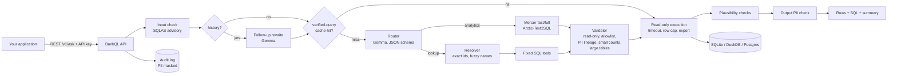

# BankQL — report

Generated 2026-11-04 by `eval/make_report.py` from `eval/results/`. Hardware, models and data for
each run are in the result files; numbers below are only what was measured — "not run" means no result yet.

## What was built

A read-only natural-language → SQL service for bank data on local models (llama.cpp): REST API (primary), Python
library, MCP server and OpenAI-compatible endpoint; deterministic lookups with fixed SQL; analytics through a ported
Mercer pipeline on Arctic-Text2SQL-R1-7B; sqlglot validator with PII lineage, the PII-filter permission and the
small-count rule; per-key policy; audit log. See README.md, docs/CONNECT.md, docs/SECURITY.md, docs/LATENCY.md.

## Architecture

## Lookup accuracy (Phase 3, router = Gemma)

_Not run yet (`scripts/eval_local.sh`)._

## BIRD financial (Phase 4, SQL = Arctic via Mercer)

Headline = BIRD's official execution accuracy (rows compared as sets, `bird-bench/mini_dev` `calculate_ex`).
"with evidence" passes BIRD's hint; "without" does not.

_Not run yet (`scripts/eval_local.sh`)._

### Failure examples

_No failures recorded (or not run)._

## Chat smoke test (real models)

_Real-model chat smoke not run yet._

## Latency

Pipeline without models (FakeLLM, `eval/latency.py`): request mean **16.45 ms** (before optimisations 39.07 ms), p95 56.6 ms; LLM calls per analytics question 5.2 → 2.2. Details: docs/LATENCY.md.

_Real-model latency not run yet._

## Spot-check

_Nothing to spot-check yet._

## Known limitations

- Differencing attacks on PII counts (keys with `pii_filter` only); per-user identity not yet enforced — docs/SECURITY.md.
- Rate limiter and sessions are per process; the verified-query cache is per instance.
- Dialects beyond SQLite / DuckDB / PostgreSQL are untested (driver + config only).
- Summaries are model text checked for numbers, contacts and instructions — treat them as untrusted in the calling app.

## Next steps

- Calibrate `router.confidence_threshold` from the table above; tune `sql.max_tokens` against truncated answers.
- Compare `link_schema: auto` vs `always` and fast vs full mode on this hardware.
- Per-user identity → database roles; query budgets for PII-filter keys.
